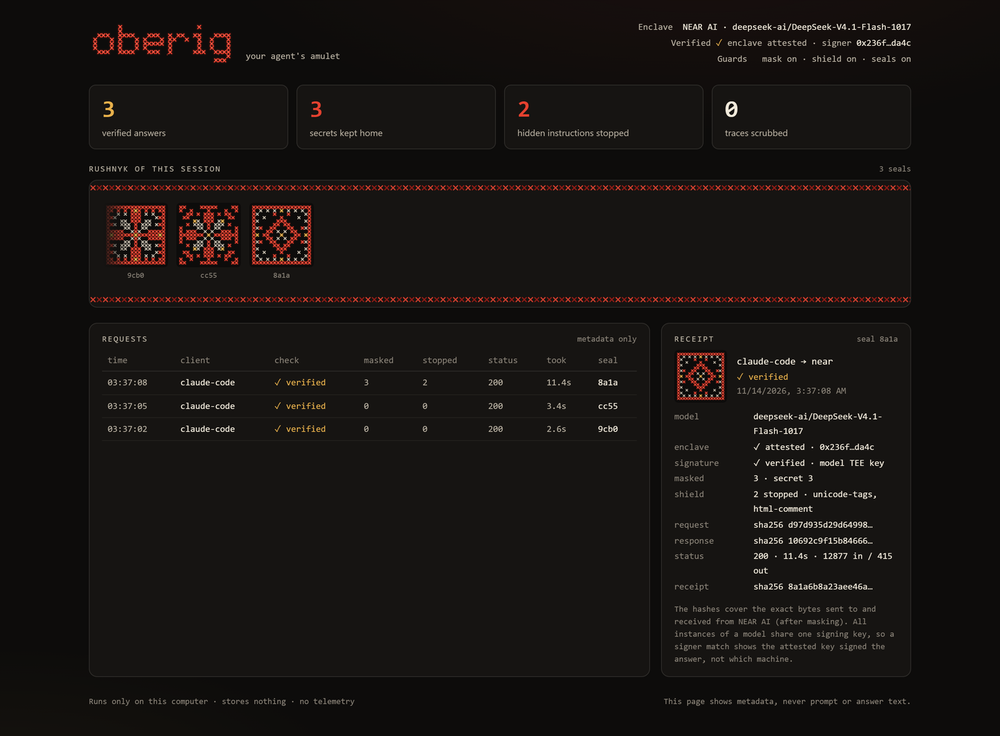

# oberig



**Your agent's amulet.** Private AI you can check.

Oberig is a small local guard that sits between your coding agent (Claude Code, Codex, OpenCode) and NEAR AI Cloud. It sends prompts only to an enclave it has verified, masks your secrets first, stops hidden instructions before the model reads them, and gives every answer a stitched seal you can check.

- **Verify** the NEAR AI enclave before the first prompt (Intel TDX quote, nonce, signing key, event log) and every answer's signature after it. `OBERIG_VERIFY=full` adds Intel's TCB status and revocation lists and NVIDIA's signed GPU verdict, all checked on your computer.
- **Mask** secrets and personal data before they leave your computer, so not even the enclave sees them.
- **Shield** the model from instructions hidden in what your agent reads. In the [benchmark](#shield-benchmark) it catches 92.8% of 600 hidden injections and flags 1.4% of real documents it was not tuned on.
- **Seal** every answer with a receipt and a cross-stitch seal drawn from the receipt's hash.
- **Anchor** a session's receipts on NEAR: one Merkle root in SocialDB that anyone can check with a free view call.
- **Scrub** agent traces before you share them as open data.

Built for NEAR AI Cloud (`cloud-api.near.ai`): every model request goes there, with no other provider and no fallback. Runs on `127.0.0.1` only, stores nothing on disk, no telemetry. Zero dependencies, Node.js 18.17 or newer, MIT. Windows, macOS and Linux.

### Tested live

On 14 Nov 2026, against NEAR AI Cloud (DeepSeek V4.1 Flash 1017):

- **Claude Code.** A real `claude -p` run through Oberig on a small project whose README hides two instructions: 3 requests, every answer's signature verified with the model's TEE key, the 3 keys in its `.env` masked, both hidden instructions stopped. The dashboard above is from that run.
- **Codex and OpenCode style requests.** Responses requests (streaming, and a tool loop with a function call and its result) and Chat Completions requests (plain, streaming, with a tool): every answer's signature verified.
- **Verify.** `oberig verify` passed every local check. With `OBERIG_VERIFY=full`: Intel TCB status UpToDate for the model and the gateway, Intel's TCB info, QE identity and revocation lists signed and current, and 16 of 16 GPUs passing in NVIDIA's signed NRAS tokens.
- **Anchor.** The `oberig anchor` dry run read NEAR mainnet and testnet. Nothing has been anchored on mainnet yet.

### How it relates to NEAR AI's own tools

NEAR AI Gateway (with its IronWire local proxy) gets your agent to NEAR AI private models in a click, and nearai-cloud-verifier checks attestation reports on demand. Oberig is a small, separate layer with zero dependencies: it checks the attestation before the first request and every answer's signature after it, refuses to send when a check fails, masks secrets so the enclave never sees them, strips hidden instructions from tool results, and runs the same on Windows, macOS and Linux. It has not been tested together with the Gateway app.

*Oberig (оберіг) is Ukrainian for a protective amulet. In folk embroidery, the stitched pattern itself was the oberig.*

---

## Quick start

You need Node.js 18.17 or newer and a NEAR AI Cloud API key (cloud.near.ai: buy credits, then create a key). Oberig reads the key from `NEARAI_API_KEY`, or from `NEAR_AI_API_KEY` if the first is not set. It never reads keys from files.

**PowerShell**

```powershell
npx github:oberiglabs-dev/oberig verify
$env:NEARAI_API_KEY = "<your key>"; npx github:oberiglabs-dev/oberig
```

**macOS / Linux**

```sh
npx github:oberiglabs-dev/oberig verify
NEARAI_API_KEY="<your key>" npx github:oberiglabs-dev/oberig
```

The first line checks the NEAR AI enclave and needs no key. The second starts the gateway. The first time, npx asks once before it fetches Oberig from GitHub. If PowerShell says running scripts is disabled, type `npx.cmd` instead of `npx`.

Or run it from a clone:

```powershell
git clone https://github.com/oberiglabs-dev/oberig; cd oberig
$env:NEARAI_API_KEY = "<your key>"; node bin/oberig.js
```

```sh
git clone https://github.com/oberiglabs-dev/oberig && cd oberig
NEARAI_API_KEY="<your key>" node bin/oberig.js
```

You see this (your signer and address will differ):

```
  ×   ×
×   ×   ×   OBERIG v0.2.0
  ×   ×     your agent's amulet
Enclave    NEAR AI · deepseek-ai/DeepSeek-V4.1-Flash-1017
Verified   ✓ enclave attested · signer 0x236f…da4c
Guards     mask on · shield on · seals on
Privacy    runs only on this computer · stores nothing · no telemetry
Address    http://127.0.0.1:8790  (dashboard: open it in a browser)
```

Then point your agent at it (next section). Each request prints one metadata-only line, for example:

```
14:05:02  claude-code → near ✓ verified  ◆ masked 2  ⚑ stopped 1  200  1.8s  seal 7f3a
```

The live dashboard is at `http://127.0.0.1:8790/`.

The rest of this README writes `oberig` for the command: that is `npx github:oberiglabs-dev/oberig`, or `node bin/oberig.js` in a clone, or `oberig` after `npm install -g .` in the repo folder.

### Try it without a key

These need no NEAR AI key:

```sh
npx github:oberiglabs-dev/oberig verify          # fetch a fresh attestation and print the enclave receipt
OBERIG_VERIFY=full npx github:oberiglabs-dev/oberig verify   # also Intel PCS collateral and NVIDIA NRAS
npx github:oberiglabs-dev/oberig shield README.md
npx github:oberiglabs-dev/oberig scrub ./some-traces
npx github:oberiglabs-dev/oberig verify --json > receipt.json
npx github:oberiglabs-dev/oberig anchor --receipts receipt.json --account name.near   # dry run: reads NEAR, sends nothing
node --test test/                                # in a clone: 164 tests, offline (mocked services)
node bench/run.js                                # in a clone: the shield benchmark, offline
```

`oberig verify --chat` also sends one short test prompt and checks its signature. That needs a key and costs a tiny amount.

---

## Connect your agent

Any model name works: Oberig always uses the configured NEAR AI model (default `deepseek-ai/DeepSeek-V4.1-Flash-1017`). The agent's own API key is ignored and never forwarded. `oberig setup` prints these lines for your port.

### Claude Code

Claude Code speaks the Anthropic Messages API. Oberig serves `/v1/messages` (streaming and tool use) and translates it to NEAR AI's Chat Completions.

```powershell
$env:ANTHROPIC_BASE_URL = "http://127.0.0.1:8790"; $env:ANTHROPIC_AUTH_TOKEN = "oberig"; claude
```

```sh
ANTHROPIC_BASE_URL=http://127.0.0.1:8790 ANTHROPIC_AUTH_TOKEN=oberig claude
```

Optional: `CLAUDE_CODE_DISABLE_NONESSENTIAL_TRAFFIC=1` turns off Claude Code's own non-essential network calls (telemetry, error reports, update checks).

### Codex

Codex speaks only the OpenAI Responses API. Oberig serves it at `/v1/responses`: each request becomes a Chat Completions request for NEAR AI, and the answer goes back as Responses events, so attestation, mask, shield and signature check work the same as for every other agent. In `~/.codex/config.toml` (the first two lines go above any `[section]`):

```toml
model = "deepseek-ai/DeepSeek-V4.1-Flash-1017"
model_provider = "oberig"

[model_providers.oberig]
name = "Oberig"
base_url = "http://127.0.0.1:8790/v1"
```

No `env_key` and no `wire_api` line are needed: Oberig ignores the agent's key, and `responses` is the only wire API current Codex knows. Codex reads providers from this user file only, not from a project's `.codex/config.toml`. Hosted tools such as Codex's web search are left out, because NEAR AI Cloud runs only the model.

### OpenCode

OpenCode talks to `/v1/chat/completions`. In `opencode.json` (or `~/.config/opencode/opencode.json` for every project):

```json
{
  "$schema": "https://opencode.ai/config.json",
  "model": "oberig/deepseek-ai/DeepSeek-V4.1-Flash-1017",
  "providers": {
    "oberig": {
      "name": "Oberig",
      "package": "@opencode/ai/providers/openai-compatible",
      "settings": { "baseURL": "http://127.0.0.1:8790/v1" },
      "models": { "deepseek-ai/DeepSeek-V4.1-Flash-1017": {} }
    }
  }
}
```

This is the OpenCode 2 shape. OpenCode 1.x uses `"provider"` with `"npm": "@ai-sdk/openai-compatible"` and `"options": { "baseURL": "http://127.0.0.1:8790/v1" }`, and OpenCode 2 still reads that older shape.

### Other tools

Any OpenAI-compatible client: base URL `http://127.0.0.1:8790/v1` (Chat Completions or Responses), any API key.

---

## What happens to a request

```
agent ──► Oberig on 127.0.0.1 ─────────────────────────────────────────────► NEAR AI Cloud
           1. verify   fresh attestation for the model (before sending, re-checked every 10 min)
           2. shield   hidden instructions in tool results are cut out
           3. mask     secrets and personal data become [[OBERIG_*]] placeholders
           4. send     exact bytes hashed (SHA-256), canonical model ID, x-no-aliasing
           5. restore  placeholders put back locally, also inside tool-call arguments
           6. seal     answer signature checked against the exact bytes; receipt + stitched seal
```

If the attestation check fails, nothing is sent and the agent gets a clear error (`OBERIG_REQUIRE_ATTESTATION=1`, the default).

---

## Verify: what is checked and what is not

Before the first request (and again after 10 minutes, or when an answer's signer does not match), Oberig asks `GET /v1/attestation/report` for the model with its own random 32-byte nonce, `provider=near`, `signing_algo=ed25519` and the header `x-no-aliasing: true`. The report is fetched before any prompt is sent; a report fetched after an answer is never used for it.

By default every check runs on your computer and nothing but NEAR AI is contacted. With `OBERIG_VERIFY=full` Oberig also fetches Intel's collateral for each quote from Intel PCS and asks NVIDIA NRAS for the GPU verdict, and checks both answers itself with `node:crypto`.

| Check | Default | `OBERIG_VERIFY=full` |
|---|---|---|
| Report returned for this exact model (non-empty `model_attestations`), every candidate checked | ✓ | ✓ |
| Fresh nonce echoed by the service | ✓ | ✓ |
| Intel TDX quote signed by an Intel-rooted key: attestation key signature, QE report binding, QE report signed by the PCK certificate, PCK chain to the pinned Intel SGX Root CA (SHA-256 `44:A0:19:6B:…:74:D3`), validity dates | ✓ | ✓ |
| Nonce bound in the quote's report data | ✓ | ✓ |
| Signing key bound in the quote's report data (the signer Oberig then pins) | ✓ | ✓ |
| TD debug mode off | ✓ | ✓ |
| App configuration measured: MRCONFIGID = `01 ‖ sha256(app_compose) ‖ 0…` | ✓ | ✓ |
| RTMR3 replayed from the event log | ✓ | ✓ |
| NVIDIA GPU evidence carries our nonce | ✓ | ✓ |
| NEAR AI gateway enclave: the same quote checks | ✓ | ✓, plus the Intel collateral checks below |
| Intel TDX TCB Info for the FMSPC in the PCK certificate: issuer chain (`TCB-Info-Issuer-Chain` header) to the pinned root, signed by the Intel SGX TCB Signing certificate, ECDSA P-256 signature over the exact `tcbInfo` bytes, `issueDate` ≤ now ≤ `nextUpdate`, FMSPC and PCE ID match the PCK certificate | not checked | ✓ |
| Intel TDX QE Identity: issuer chain (`SGX-Enclave-Identity-Issuer-Chain` header) to the pinned root, signature over the exact `enclaveIdentity` bytes, `issueDate` ≤ now ≤ `nextUpdate` | not checked | ✓ |
| Revocation: the PCK CRL (platform or processor CA; signed by the CA that issued the PCK certificate, its `SGX-PCK-CRL-Issuer-Chain` header checked) and the Intel SGX Root CA CRL (signed by the pinned root), both within `thisUpdate` and `nextUpdate`; neither the PCK certificate, its CA nor the TCB signing certificate is listed | not checked | ✓ |
| Quoting enclave matches the QE Identity: MRSIGNER, ISVPRODID, MISCSELECT and ATTRIBUTES under their masks, ISVSVN to a TCB level | not checked | ✓ |
| TDX module matches the TCB Info: the `tdxModuleIdentities` entry `TDX_<TEE TCB SVN[1]>` (or `tdxModule` when that byte is 0), MRSIGNERSEAM, SEAM attributes under the mask, module SVN (TEE TCB SVN[0]) to a TCB level | not checked | ✓ |
| Intel TCB status, for the model and for the gateway: the first of Intel's `tcbLevels` the platform meets (every PCK SGX TCB component and the PCESVN, then the quote's TEE TCB SVN: all 16 bytes, or bytes 2 to 15 when TEE TCB SVN[1] > 0), merged with the QE and TDX module statuses (OutOfDate there makes the platform OutOfDate, Revoked makes it Revoked) | not checked | ✓ status shown, policy below |
| NVIDIA NRAS tokens: every token (one overall, one per GPU) is an ES384 JWT signed by a key from NRAS's key set (`https://nras.attestation.nvidia.com/.well-known/jwks.json`, over HTTPS) and issued by `https://nras.attestation.nvidia.com` | not checked | ✓ |
| NRAS tokens carry our nonce (`eat_nonce`) and are within `nbf` and `exp` (60 s clock skew) | not checked | ✓ |
| GPU verdict from NRAS, for every candidate: `x-nvidia-overall-att-result` is true; the overall token binds each GPU token by its SHA-256 (`submods`); one GPU token per evidence entry sent; every GPU passes NVIDIA's per-GPU claims (measurements `success`, report signature, nonce and certificate chain, driver and VBIOS reference values, no VBIOS index conflict, secure boot on, debug off) | not checked | ✓ |
| Image provenance (Sigstore), measurement allow-lists | not checked | not checked |

**TCB policy (full mode).** `UpToDate` passes. `SWHardeningNeeded`, `ConfigurationNeeded`, `ConfigurationAndSWHardeningNeeded`, `OutOfDate` and `OutOfDateConfigurationNeeded` are shown in the receipt with ✗ and the status text, plus Intel's advisory IDs, and count as a warning: the request is still sent. `OBERIG_REQUIRE_TCB=uptodate` refuses everything except `UpToDate`. `Revoked`, an unknown status, a platform no TCB level matches, or a quoting enclave or TDX module that does not match Intel is always refused.

**Full mode fails closed.** A collateral document or NRAS answer that cannot be fetched or does not verify counts as a failed check, so with `OBERIG_REQUIRE_ATTESTATION=1` nothing is sent. Intel's documents and NRAS's key set are kept in memory for 30 minutes and checked again on every use; a token signed by a key that is not in the cached set triggers one fresh fetch of the set. NRAS is asked again for every new attestation, because its tokens carry the fresh nonce.

**What full mode sends.** Intel PCS gets plain GET requests that name the FMSPC from NEAR AI's PCK certificate. NRAS gets NEAR AI's GPU evidence from the report, unchanged, which includes your nonce. Neither gets your prompts or your key.

After each answer Oberig fetches `GET /v1/signature/{id}` and checks:

- the signed text is `<model>:<sha256 of the request bytes Oberig sent>:<sha256 of the response bytes it received>` (or `<request>:<response>` for a gateway signature)
- the Ed25519 signature verifies (ECDSA/EIP-191 is supported too, with small built-in keccak256 and secp256k1 modules)
- the signer is the key pinned from the attestation

The answer reaches your agent first; the signature check follows and lands in the log line and the receipt. The signature covers the masked request, so a valid signature also shows the enclave received placeholders, not your secrets.

**Limits, as NEAR AI states them, and as the receipts say them:**

- All instances of a model share one signing key. A signer match shows the attested key signed the answer, not which machine answered.
- Preflight evidence plus one response signature is not yet a complete model-to-gateway-to-answer chain.
- By default Oberig asks NEAR AI non-streaming, with the canonical model ID and `x-no-aliasing: true`, to get a model-level (`provider_tee`) signature, then streams to your agent locally. With `OBERIG_UPSTREAM_STREAM=1` it streams from NEAR AI and expects a gateway signature over the exact stream bytes. Which kind a given answer carries is shown in its receipt.
- The NRAS key set is trusted as NVIDIA serves it over HTTPS; Oberig does not pin an NVIDIA root for it.

`oberig verify` prints the receipt:

```
  OBERIG · enclave receipt

  model     deepseek-ai/DeepSeek-V4.1-Flash-1017
  service   NEAR AI Cloud · provider near
  mode      local · only NEAR AI contacted
  ...
  ✓  TDX quote signed by an Intel-rooted key
  ✓  nonce bound in quote report data
  ✓  signer bound in quote report data
  ...
  ·  Intel TCB status, QE identity, CRLs: not checked locally (OBERIG_VERIFY=full checks them)
  ·  GPU verdict (NVIDIA NRAS): not checked locally (OBERIG_VERIFY=full checks it)

  result    ✓ enclave attested
```

With `OBERIG_VERIFY=full`, from a live run on 14 Nov 2026 (`OBERIG_VERIFY=full OBERIG_REQUIRE_TCB=uptodate oberig verify --chat`; both model candidates on FMSPC `90c06f000000` with TDX module `TDX_01` SVN 11 and QE ISVSVN 6, the gateway on FMSPC `70a06d070000` with `TDX_03` SVN 9; NRAS: 2 overall and 16 GPU tokens):

```
  mode      full · Intel PCS collateral and NVIDIA NRAS checked here
  ...
  ✓  gateway enclave quote checked
  ✓  Intel TCB info signed by Intel and current
  ✓  Intel QE identity signed by Intel and current
  ✓  certificates not revoked (Intel PCK and Root CA CRLs)
  ✓  quoting enclave matches Intel QE identity
  ✓  TDX module matches Intel TCB info
  ✓  Intel TCB status: UpToDate
  ✓  gateway Intel TCB status: UpToDate
  ✓  NVIDIA attestation tokens signed (ES384, NRAS keys)
  ✓  NVIDIA tokens carry our nonce and are not expired
  ✓  GPU verdict (NVIDIA NRAS)
  ✓  test answer signature verified (model TEE key)

  result    ✓ enclave attested
```

A TCB status other than UpToDate shows as, for example, `✗  Intel TCB status: OutOfDate  warning only, still sent (OBERIG_REQUIRE_TCB=uptodate refuses) · INTEL-SA-…`, and the result can still be `✓ enclave attested`. `--details` adds each check's detail (FMSPC, next update dates, ISVSVN, GPU counts). The receipt ends with its stitched seal and 4-character id. Exit code 0 means attested.

---

## Mask

Before a request leaves your computer, secrets and personal data are replaced with placeholders, so not even the enclave sees them:

`[[OBERIG_SECRET_1]]` `[[OBERIG_EMAIL_1]]` `[[OBERIG_PHONE_1]]` `[[OBERIG_CARD_1]]` `[[OBERIG_TERM_1]]`

- Numbering is stable for the session: the same value always gets the same placeholder.
- Answers are restored locally, including inside tool-call arguments (with JSON escaping) and across streamed chunks.
- Patterns cover private keys, common API key and token formats, NEAR private keys, JWTs, database passwords in URLs, bearer tokens, seed phrases, wallet keys, `*_SECRET=`/`*_TOKEN=`/`*_KEY=`/`*_PASSWORD=` style assignments, emails, international phone numbers and card numbers (Luhn-checked). Add your own words with `OBERIG_TERMS`.
- The map between values and placeholders lives in memory only and is gone when Oberig stops.

Pattern matching can miss a secret in an unusual format. Treat Mask as a seatbelt, not a guarantee.

## Shield

Oberig scans what your agent is about to send to the model for hidden instructions:

- HTML comments and markdown link definitions (`[//]: # (...)` and any other label) that carry instructions
- runs of zero-width and invisible characters (variation selectors too), Unicode tag characters (decoded and shown), bidi controls
- CSS-hidden text in HTML that carries instructions: `display:none`, `visibility:hidden`, tiny or transparent text, off-screen or clipped boxes, text the same colour as its background, hiding classes from a `<style>` block
- instructions in `alt`, `title`, `aria-label` and similar attributes, hidden inputs and meta tags
- "ignore previous / system / developer instructions" style directives and fake chat-template markers
- instructions aimed at the agent to run remote scripts (`curl … | sh`, `iwr … | iex` and similar)
- markdown images and links that carry data out in the query string

Tool results (web pages, READMEs, issues, emails, files the agent read) get every rule. Text you typed yourself only gets the hidden-content rules, so your own words are never rewritten. System prompts and the model's own messages are not touched.

Hidden text counts as an instruction when it addresses an AI agent, overrides earlier instructions, asks to keep something from you, talks about the reply or what to tell you, runs a remote script, or reads or sends secrets. The rules know cues like these in English and in 15 other languages (German, French, Spanish, Portuguese, Italian, Dutch, Polish, Bosnian/Croatian/Serbian, Russian, Ukrainian, Turkish, Chinese, Japanese, Korean, Arabic). In tab panels and dialogs, which hide install commands until you click, only the cues aimed at an agent count; a remote-script command alone does not. JSON tool results are read through their string escapes, so an encoder that writes `<` or an invisible character as a unicode escape does not hide it.

| `OBERIG_SHIELD` | Behaviour |
|---|---|
| `block` (default) | hidden parts are removed or replaced, and one short note is added for the model: `[oberig: removed hidden instructions from this content]` |
| `warn` | findings are counted and logged; nothing is changed |
| `off` | no scanning |

`oberig shield <file>` shows what it finds in any file (exit code 1 when something is found). The same `src/shield.js` runs in a browser.

**Limits.** The shield is a pattern scanner. It raises the cost of common tricks; it does not understand intent. It can miss new phrasings, languages it has no words for, instructions inside images, and encoded payloads (for example base64 that the model is asked to decode). Instructions written in plain view are not its target. It also flags harmless hidden notes to agents, such as the "if you are an AI agent" comments some pull request templates now carry, and it can cut legitimate text, for example when your agent reads a test suite full of injection examples. Use `OBERIG_SHIELD=warn` for that kind of work. See [Shield benchmark](#shield-benchmark) for measured rates.

## Shield benchmark

`bench/` measures the shield on hidden prompt injections and on ordinary content. It runs offline in about a second:

```sh
node bench/run.js            # tables
node bench/run.js --misses   # every miss and every flagged document
```

- **600 hidden injections**, generated: 10 techniques, 60 samples each, in READMEs, GitHub issues, HTML pages, emails and JSON tool results, in 22 languages, with harmless payloads (`.invalid` domains). 185 of them use held-out phrasings (other wordings, and six languages the rules have no words for) that were never used for tuning.
- **724 ordinary documents**, real and cached in `bench/fixtures/` with their source URL and license: READMEs of 307 popular GitHub repositories, 241 issue and pull request templates, 70 documentation pages as raw HTML and 106 open-source email templates. 222 of them were fetched after the rules were frozen; RESULTS.md notes the one change made after that.

| Hidden technique | Detected | Held-out phrasings | Before |
|---|---:|---:|---:|
| HTML comment | 88.3% | 61.1% | 21.7% |
| Markdown reference comment | 90.0% | 64.7% | 10.0% |
| Zero-width and invisible characters | 100% | 100% | 73.3% |
| Unicode tag characters | 100% | 100% | 93.3% |
| Bidi controls | 100% | 100% | 90.0% |
| CSS-hidden HTML | 90.0% | 64.7% | 10.0% |
| Hidden alt or title attribute | 90.0% | 64.7% | 0% |
| Override phrase ("ignore previous …") in a hidden carrier | 78.3% | 45.8% | 23.3% |
| `curl \| sh` or `iwr \| iex` in a hidden carrier | 100% | 100% | 46.7% |
| Markdown image or link exfiltration | 91.7% | 73.7% | 80.0% |
| **All 600** | **92.8%** | **76.8%** | 44.8% |

| Ordinary content | Flagged | Before |
|---|---:|---:|
| Tuning set, 502 documents | 14 (2.8%) | 78 (15.5%) |
| Held-out set, 222 documents | 3 (1.4%) | 20 (9.0%) |

"Before" is the shield before this benchmark, on the same data. The 14 flagged tuning documents are pull request and issue templates with hidden notes about AI agents or AI use ("if you are an AI agent, ...", "AI agents must ..."): hidden instructions to agents, flagged by design, but harmless. The 3 held-out ones are READMEs whose badge tokens or LaTeX image URLs look like data in a query string.

A scan takes about 0.2 ms for the median document and under 5 ms at the 95th percentile; the slowest, a 950 KB Wikipedia page of raw HTML, takes under 0.1 s (about 28 MB/s on one core of the test machine).

Visible plain-text injections are out of scope: the shield looks for instructions hidden from you. Written as ordinary sentences, 0 of 24 visible injections are detected; in plain view only override directives and remote-script commands aimed at the agent are acted on (10 of 15 visible override phrasings caught). Full results: [bench/RESULTS.md](bench/RESULTS.md).

## Seal


Every request gets a receipt, kept in memory with metadata only: time, client, model, attestation status (signer, nonce), response signature status and kind, masked counts, shield findings, SHA-256 of the request and response bytes, HTTP status, timing, and a short id. From the receipt's own hash Oberig draws a deterministic cross-stitch seal in the vyshyvanka tradition (8-fold symmetry, red, black and a little gold). The same receipt always gives the same seal.

The dashboard at `http://127.0.0.1:8790/` shows the session as a growing embroidered band (a rushnyk) of seals, with counters (verified answers, secrets kept home, hidden instructions stopped, traces scrubbed) and the request list. Hover a seal to read its receipt. It never shows prompt or answer text.

## Anchor: receipts on NEAR

`oberig anchor` puts one Merkle root of the session's receipt hashes on the NEAR blockchain, under your own NEAR account. Afterwards anyone can check, with a free view call, that a sealed answer existed by then. NEAR AI Cloud gives the answer; NEAR keeps the proof.

What goes on chain is one SocialDB record (`social.near` on mainnet, `v1.social08.testnet` on testnet), written with SocialDB's `set`:

```
key    <your-account>/oberig/anchors/<root>
value  {"v":1,"tree":"rfc6962-sha256","n":12,"t":"2026-11-14T03:21:07Z","app":"oberig/0.2.0"}
```

- The root is a SHA-256 Merkle tree in the Certificate Transparency form (RFC 6962) over the receipt hashes, oldest first. Receipts hold metadata only, and the chain gets only the root: no receipts, prompts or answers.
- The transaction is built and signed on your computer (borsh and Ed25519 with `node:crypto`, no NEAR libraries) and sent with `broadcast_tx_commit` to `rpc.mainnet.near.org` (`rpc.mainnet.fastnear.com` if that does not answer; `NEAR_RPC_URL` sets your own).
- The gateway itself never talks to NEAR. `oberig anchor` reads the receipt hashes from it on `127.0.0.1` and, after a successful anchor, tells it which root it published. The gateway checks that the hashes give that root, then marks those receipts with ◈ in the dashboard: in the status line, under the seals, in the request list and in the receipt.

**Dry run (the default).** Only view calls; nothing is signed or sent:

```sh
oberig anchor                       # the running gateway's receipts
oberig anchor --receipts r.json     # or a file: receipts, receipt hashes, a saved gateway state or "oberig verify --json" output
```

It shows the account and its balance, the network and RPC, the contract and method, the record (key and value), whether the account is registered in SocialDB, the signing key (when `NEAR_PRIVATE_KEY` is set), the cost and the root, and names anything that would stop a send (for example an empty account).

**Publish.** Set `NEAR_ACCOUNT_ID` (for example `name.near`) and `NEAR_PRIVATE_KEY` (`ed25519:...`, a full-access key of that account, exported from your wallet) in the environment, then:

```sh
oberig anchor --send --out anchor.json
```

It prints the transaction hash and a nearblocks.io link, and reads the record back with a view call. `--out` saves the root and every leaf, so you can prove any receipt after the gateway stops. Oberig reads the key only from the environment, never from a file, and never prints it; it shows only the public key.

**Check.** A view call: free, and it needs no key or NEAR account:

```sh
oberig anchor --check <root> --account name.near
oberig anchor --check <receipt-hash>                                   # while the gateway that anchored it runs
oberig anchor --check <receipt-hash> --receipts anchor.json --out proof.json
oberig anchor --check <receipt-hash> --proof proof.json                # anyone with the proof file
```

For a receipt, Oberig first checks the inclusion proof from the receipt hash to the root, then looks the root up on chain. Exit code 0 means the record was found. `--network testnet` uses testnet; mainnet is the default.

**Cost** on NEAR mainnet (14 Nov 2026). The dry run shows the numbers for your account.

| | First anchor | Each later anchor |
|---|---|---|
| Storage kept in SocialDB (0.00001 NEAR per byte) | about 1,460 bytes, 0.015 NEAR: it also registers the account in SocialDB and creates `oberig/anchors` | about 400 bytes, 0.004 NEAR |
| Gas burnt | about 0.0005 NEAR | about 0.0005 NEAR |
| Attached while it runs, unused part refunded | 0.02 NEAR deposit (SocialDB's minimum for a new account) and a gas reserve of about 0.031 NEAR | about 0.009 NEAR deposit and the same gas reserve |

- Oberig sets SocialDB's `refund_unused_deposit`, so the part of the deposit the record does not use comes back in the same transaction. The storage stays locked in SocialDB for as long as the record exists.
- The gas figure comes from a real SocialDB write of similar size on mainnet (3.7 TGas, 0.00037 NEAR). Oberig attaches 30 TGas; NEAR buys attached gas up front at its minimum purchase price and refunds what is not used.
- About 0.052 NEAR must be available for the first anchor. 0.2 NEAR covers it and dozens more.

**Status.** Nothing has been anchored on mainnet yet. Tested on 14 Nov 2026: the dry run ran live against NEAR mainnet and testnet (view calls only), with receipts from a live gateway session and from `oberig verify --json`; the transaction encoding was checked against three real mainnet transactions (re-serialized, their SHA-256 matched the on-chain hashes and their signatures verified); `--send` is tested end to end against a mock NEAR RPC that checks the signature, access key, nonce and block hash.

## Scrub

`oberig scrub <file|folder>` writes sanitised copies of agent traces that are safer to share as open data, for example when a project asks people to contribute their agent traces.

```sh
oberig scrub ~/.claude/projects/my-project          # writes ~/.claude/projects/my-project-scrubbed/
oberig scrub ./session.jsonl                         # writes ./session.scrubbed.jsonl
oberig scrub ~/.codex/sessions --out ./codex-clean
```

- Handles Claude Code JSONL transcripts, Codex logs, and any text or JSON file. JSON stays valid JSON and JSONL stays one object per line.
- Masks secrets, emails, phone numbers and card numbers; turns home folders (`C:\Users\name`, `/Users/name`, `/home/name`) into `~`; replaces your user name, machine name, private IP addresses and `.local`/`.internal`/`.corp`/`.lan` host names with `[[OBERIG_USER_n]]` and `[[OBERIG_HOST_n]]`.
- Never changes the originals, refuses to write inside the input folder, skips binary files, uploads nothing.
- Prints a summary. If a gateway is running, it adds the file count to the dashboard counter.

Read the copies before you share them. Pattern matching can miss things.

---

## Configuration

All settings come from the environment. There is no config file.

| Variable | Default | Meaning |
|---|---|---|
| `NEARAI_API_KEY` | | Your NEAR AI Cloud key. `NEAR_AI_API_KEY` is read if this is not set. |
| `OBERIG_MODEL` | `deepseek-ai/DeepSeek-V4.1-Flash-1017` | NEAR AI model. It must return a NEAR model attestation (`provider=near`), or nothing is sent. |
| `OBERIG_PORT` | `8790` | Local port (also `oberig start --port N`). Oberig always binds `127.0.0.1`. |
| `OBERIG_REQUIRE_ATTESTATION` | `1` | `1`: nothing is sent unless the attestation check passes. `0`: send anyway and mark answers `unverified`. |
| `OBERIG_VERIFY` | `local` | `full` also fetches Intel's PCS collateral (TCB info, QE identity, CRLs) and asks NVIDIA NRAS for the GPU verdict, and checks both answers locally. See Verify. |
| `OBERIG_REQUIRE_TCB` | `warn` | With `OBERIG_VERIFY=full`: `warn` shows a TCB status other than `UpToDate` as a warning and still sends; `uptodate` refuses unless the status is `UpToDate`. `Revoked` is always refused. |
| `OBERIG_SIGNING_ALGO` | `ed25519` | `ecdsa` uses EIP-191 signatures instead. |
| `OBERIG_ATTEST_TTL` | `600` | Seconds before the attestation is fetched and checked again (minimum 60). |
| `OBERIG_SHIELD` | `block` | `block`, `warn` or `off`. |
| `OBERIG_MASK` | `1` | `0` turns masking off. |
| `OBERIG_MASK_PII` | `1` | `0` masks secrets only (no emails, phones, cards). |
| `OBERIG_TERMS` | | Comma-separated words to always mask, for example client or project names. |
| `OBERIG_UPSTREAM_STREAM` | `0` | `1` streams from NEAR AI (gateway signature) instead of asking non-streaming (model signature). |
| `OBERIG_MAX_TOKENS` | `32768` | Upper bound for `max_tokens` on translated Claude Code requests. |
| `OBERIG_QUIET` | `0` | `1` hides the per-request log lines. |
| `NO_COLOR` | | Set to turn off terminal colours. |
| `NEAR_ACCOUNT_ID` | | Your NEAR account for `oberig anchor`, for example `name.near`. `--account` also works. |
| `NEAR_PRIVATE_KEY` | | Its key, `ed25519:...`. Only `oberig anchor --send` needs it. Read only from the environment and never printed. |
| `NEAR_RPC_URL` | `https://rpc.mainnet.near.org` | NEAR RPC for `oberig anchor` (testnet default: `https://rpc.testnet.near.org`). |

## Endpoints

| Path | Use |
|---|---|
| `POST /v1/messages` | Anthropic Messages (Claude Code), streaming and tool use |
| `POST /v1/messages/count_tokens` | local estimate, nothing is sent |
| `POST /v1/responses` | OpenAI Responses (Codex), streaming and tool calls, translated locally to Chat Completions; nothing is stored, so `previous_response_id` is refused |
| `POST /v1/chat/completions` | OpenAI Chat Completions (OpenCode, others), streaming and tool calls |
| `GET /v1/models` | the configured model |
| `GET /` | dashboard |
| `GET /_oberig/state`, `GET /_oberig/events` | dashboard data (metadata only) |
| `GET /_oberig/receipts` | receipt hashes of the session, oldest first, and its anchors (for `oberig anchor`) |
| `POST /_oberig/anchored` | `oberig anchor --send` reports a published root; accepted only when the receipt hashes give that root |

Every other path returns 404. Nothing is passed through to any other service.

## Security

- Listens on `127.0.0.1` only. Requests whose `Host` is not `localhost`, `127.0.0.1` or `[::1]` are refused (DNS rebinding).
- Requests with a browser `Origin` are refused on model routes; the dashboard only accepts its own origin.
- Model routes require `Content-Type: application/json`; bodies are capped at 32 MB.
- The NEAR AI key comes only from the environment and is sent only to `cloud-api.near.ai`. Keys and tokens your agent sends to Oberig are ignored and never forwarded.
- The NEAR key for `oberig anchor --send` comes only from `NEAR_PRIVATE_KEY`. It signs one transaction on your computer and is never printed, logged or sent anywhere; only the signed transaction leaves.
- Network traffic: `cloud-api.near.ai` only; with `OBERIG_VERIFY=full` also `api.trustedservices.intel.com` and `certificates.trustedservices.intel.com` (Intel collateral) and `nras.attestation.nvidia.com` (GPU verdict and its key set); `oberig scrub` may call your own local gateway; `oberig anchor` talks to a NEAR RPC (`rpc.mainnet.near.org` or `rpc.testnet.near.org`, `rpc.mainnet.fastnear.com` or `rpc.testnet.fastnear.com` as fallback, or `NEAR_RPC_URL`). The gateway itself makes no NEAR RPC calls.
- Nothing is written to disk by the gateway. Receipts and the placeholder map live in memory. No telemetry, no analytics.
- The dashboard is served with a strict Content-Security-Policy and loads no third-party resources.
- Zero dependencies: only Node.js built-ins (`node:http`, `node:crypto`, `node:fs`).

Found a problem? Open an issue at https://github.com/oberiglabs-dev/oberig/issues. For a security problem, please report it privately as [SECURITY.md](SECURITY.md) describes.

## Development

```sh
node --test test/
node bench/run.js
```

The tests (164, offline) cover translation and streaming (Anthropic Messages and OpenAI Responses to Chat Completions), attestation checks on captured live NEAR AI reports (Ed25519 and ECDSA) and on synthetic reports with their own test certificate chain, response signatures (good, bad, wrong bytes, wrong signer), nonce mismatch, refusal when attestation is required, masking and restoring (also in tool-call arguments), shield detections and a no-false-positive README, scrub on a sample Claude Code transcript, routing through a mocked NEAR AI server, the security rules, and the CLI.

Full mode is tested on a live capture (a DeepSeek V4.1 Flash report with the Intel TCB info, QE identity, CRLs and NRAS tokens fetched for it in the same run) and on a synthetic Intel PCS and NRAS with their own test keys: tampered TCB info, QE identity, CRL and token signatures, a wrong FMSPC, a foreign issuer chain, a revoked PCK serial, expired and not-yet-valid collateral, OutOfDate as a warning and as a refusal, Revoked, unreachable Intel PCS, and that default mode contacts only NEAR AI.

Anchoring is tested with base58, borsh and transaction hashes checked against three real mainnet transactions (a SocialDB write, a meta transaction and a transfer), Ed25519 signing, RFC 6962 Merkle roots and audit paths, the dry run and `--send` against a mock NEAR RPC, and the gateway's anchored marks. Test keys are assembled from pieces at runtime; no real key appears in the source.

`node bench/run.js` runs the [shield benchmark](#shield-benchmark); `--write` rewrites `bench/RESULTS.md`.

Project layout: `bin/oberig.js` (CLI), `src/server.js` (gateway), `src/verify.js` and `src/quote.js` (attestation and signatures), `src/pcs.js` (Intel PCS collateral), `src/nras.js` (NVIDIA NRAS tokens), `src/der.js` (DER reader for certificates and CRLs), `src/ecdsa.js` (keccak256, secp256k1), `src/mask.js`, `src/shield.js` (UMD), `src/translate.js` (Claude Code), `src/responses.js` (Codex), `src/streams.js`, `src/receipt.js`, `src/scrub.js`, `src/seal.js` and `src/stitch.js` (seal and stitch renderers), `src/near/` (base58, borsh, tx, rpc, merkle, anchor: NEAR transactions and anchoring), `dashboard/index.html`, `bench/` (shield benchmark: generator, runner, cached fixtures, RESULTS.md), `docs/` (README images).

## Credits

- NEAR AI Cloud for the OpenAI-compatible API, the attestation reports and the per-answer signatures. The checks follow NEAR AI's published verification documentation and its open-source verifier.
- Intel for the TDX quote format, the SGX root certificate and the PCS collateral service; NVIDIA for the NRAS service and its token keys.
- NEAR's SocialDB contract (`social.near`) for the anchor records.
- Secret patterns follow the shape of common open-source secret scanners.
- The benchmark's ordinary documents are public READMEs, templates, documentation pages and email templates, each cached with its source and license (`bench/fixtures/README.md`).
- Libraries: none. Only Node.js built-ins.

MIT License. See [LICENSE](LICENSE).
